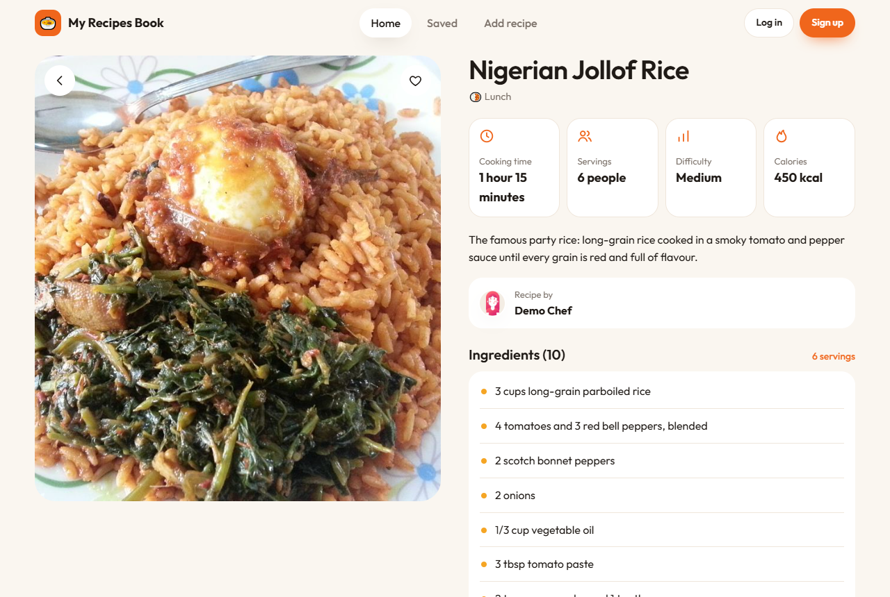
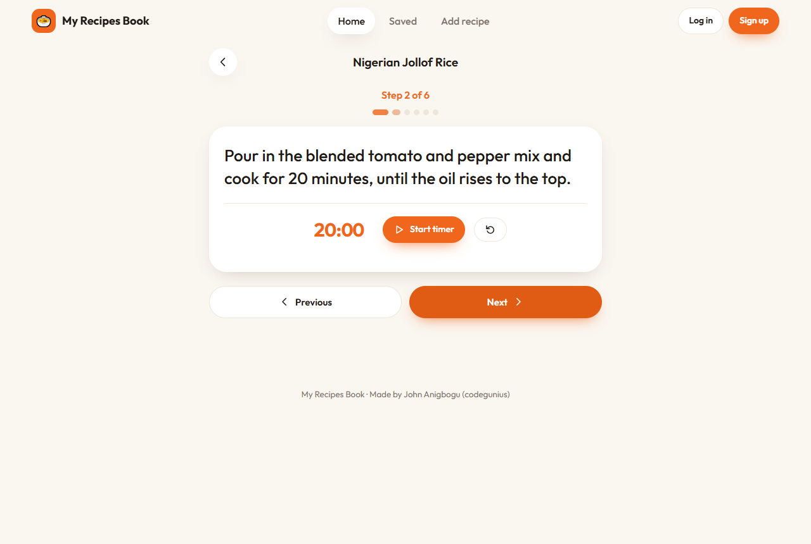
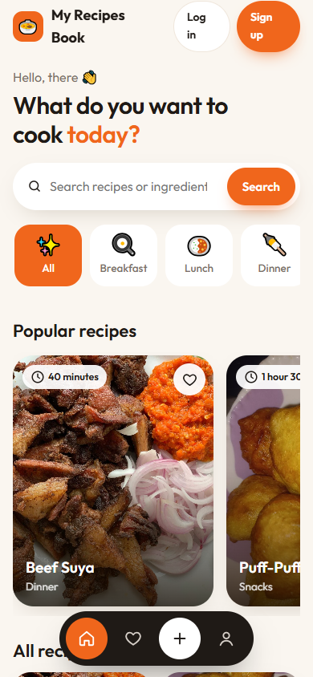

# My Recipes Book

A recipe-sharing web app built with **Laravel 12** (PHP 8.3). Search Nigerian and home recipes, filter by category, save your favourites, rate dishes and cook step by step with built-in timers. Signed-in cooks post their own recipes with a photo, and only the owner can edit or delete them.

**Live demo:** _coming soon_ · **Demo login:** `demo@recipes.test` / `demo12345` (or tap **Use demo** on the login page)

| Home | Recipe | Cooking mode | Phone |
|---|---|---|---|
|  |  |  |  |

## Features

- **Home:** greeting, search by name or ingredient, category chips (Breakfast, Lunch, Dinner, Soups, Snacks, Desserts, Drinks), popular recipes and every recipe
- **Recipe page:** large photo, cooking time, servings, difficulty and calories, ingredients, numbered steps, the cook's name, and more from the same category
- **Cooking mode:** one step at a time with Previous and Next, a progress bar, and a timer whenever a step mentions minutes ("simmer for 10 minutes")
- **Save** recipes with the heart (no page reload) and find them under **Saved**
- **Rate** other people's recipes from 1 to 5 stars; the best rated show first under Popular
- **Add and edit** recipes with photo preview, category, servings, difficulty and calories
- **Profile:** your recipes, saved count and the ratings your recipes received; edit your name, email and avatar
- Register, log in, log out and reset a password (Laravel UI)
- Built for phones first, with a bottom menu; works on desktop too, and without JavaScript

## Tech stack

| Layer | Tech |
|---|---|
| Backend | PHP 8.3, Laravel 12, Eloquent ORM, Blade templates |
| Auth | Laravel UI (login, registration, password reset) |
| Database | SQLite by default; MySQL or PostgreSQL through `DB_*` settings |
| Files | Laravel Storage (`public` disk) for recipe photos and avatars |
| Server | Apache in Docker, ready for Render |

## Project structure

```
app/
├─ Http/Controllers/   PostsController (recipes, search, cooking mode), SavedController, RatingController,
│                      HomeController (profile), UserController (edit profile), Auth/
├─ Http/Middleware/    TrustProxies (HTTPS behind a host), CSRF, cookies
├─ Post.php            recipe: categories, ingredient and step lists, step timers
├─ Rating.php          1 to 5 stars, one per user per recipe
└─ User.php            recipes, saved recipes, ratings
database/
├─ migrations/         users, recipes, recipe details, saved recipes (favorites), ratings
└─ seeds/              demo account, nine Nigerian recipes and their photos
resources/views/       layouts/, partials/ (card, heart, icons), posts/ (index, show, cook, form), saved,
                       home (profile), user/, auth/, errors/
public/css/recipes.css the design (mobile first)
public/js/recipes.js   save without reload, photo previews, cooking mode and timers
routes/web.php         recipe routes, profile routes, auth routes
docker/                Apache config and the start-up script
Dockerfile · render.yaml
```

## Security

- Only the owner can edit or delete a recipe, checked on the server for every request
- Profiles can only be changed by the signed-in owner
- Uploaded files get random names, and old files are deleted by the name stored in the database, never by a name sent from the browser
- You can't rate your own recipe, ratings must be 1 to 5, and rating again replaces your earlier rating
- CSRF protection on every form, passwords hashed with bcrypt, uploads limited by type and size

## Run it locally

You need [Docker Desktop](https://www.docker.com/products/docker-desktop/).

```bash
docker build -t recipes-app .
docker run -p 8080:8080 recipes-app
```

Open http://localhost:8080. The database, demo account and demo recipes are created on the first start.

Without Docker (PHP 8.2+ and Composer installed):

```bash
composer install
cp .env.example .env            # then set DB_DATABASE to a full path, e.g. database/database.sqlite
php artisan key:generate
touch database/database.sqlite
php artisan migrate --seed
php artisan storage:link
php artisan serve
```

## Deploy on Render (free)

1. Go to [dashboard.render.com](https://dashboard.render.com) → **New** → **Blueprint**.
2. Connect this repository. Render reads `render.yaml` and creates the web service.
3. Wait for the first deploy, then open the `.onrender.com` link.

On the free plan the service sleeps when nobody uses it and its disk is reset, so the database starts fresh with the demo recipes after each wake-up. For data that lasts, set `DB_CONNECTION=pgsql` and the `DB_*` values to a free PostgreSQL database such as [Neon](https://neon.tech).

## Photo credits

The demo recipe photos come from [Wikimedia Commons](https://commons.wikimedia.org) under Creative Commons licences (mostly CC BY-SA 4.0). Each recipe page names the photographer and links to the original file; the full list is in `database/seeds/photos/credits.json`.

## History

Started in 2018 as a Laravel 5.4 project. Upgraded in 2026 to Laravel 12 on PHP 8.3: the forms were rewritten in plain Blade (the old `laravelcollective/html` package doesn't support new Laravel), broken links and a leftover debug line were fixed, the security issues above were closed, and Docker hosting plus demo data were added. The design was then rebuilt mobile first, with categories, search, saved recipes, ratings and cooking mode.
