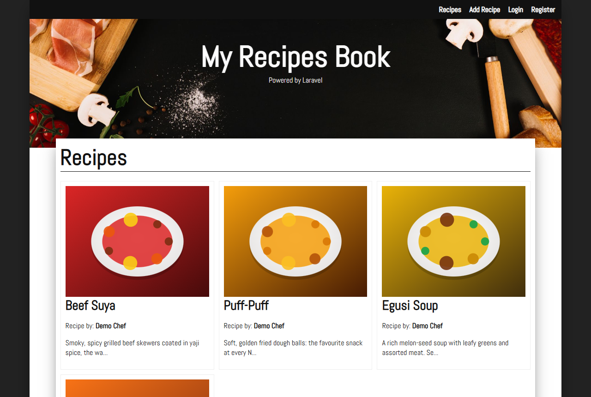

# My Recipes Book

A recipe-sharing web app built with **Laravel 12** (PHP 8.3). Anyone can browse recipes; signed-in cooks post their own with a photo, prep time, ingredients and step-by-step preparation, and only the owner can edit or delete them.

**Live demo:** _coming soon_ · **Demo login:** `demo@recipes.test` / `demo12345`



## Features

- Browse all recipes, newest first, and open any recipe for its full details
- Register, log in, log out and reset a password (Laravel UI authentication)
- Add a recipe with a photo upload (JPG, PNG, WebP or GIF, up to 2 MB)
- Edit or delete your own recipes; other people's recipes are protected
- Dashboard with your recipes, plus a profile page with a name, email and avatar
- Form validation that keeps what you typed when something is missing
- Works on phones

## Tech stack

| Layer | Tech |
|---|---|
| Backend | PHP 8.3, Laravel 12, Eloquent ORM, Blade templates |
| Auth | Laravel UI (login, registration, password reset) |
| Database | SQLite by default; MySQL or PostgreSQL through `DB_*` settings |
| Files | Laravel Storage (`public` disk) for recipe photos and avatars |
| Server | Apache in Docker, ready for Render |

## Project structure

```
app/
├─ Http/Controllers/   PostsController (recipes), UserController (profile), HomeController, Auth/
├─ Http/Middleware/    TrustProxies (HTTPS behind a host), CSRF, cookies
├─ Post.php            recipe model (belongs to a user)
└─ User.php            user model (has many recipes)
database/
├─ migrations/         users, password resets, recipes (posts), recipe owner
└─ seeds/              demo account and four Nigerian recipes with covers
resources/views/       layouts/, posts/ (index, show, create, edit), user/, auth/, home
routes/web.php         recipe routes, profile routes, auth routes
docker/                Apache config and the start-up script
Dockerfile · render.yaml
```

## Security

- Only the owner can edit or delete a recipe, checked on the server for every request
- Profiles can only be changed by the signed-in owner
- Uploaded files get random names, and old files are deleted by the name stored in the database, never by a name sent from the browser
- CSRF protection on every form, passwords hashed with bcrypt, uploads limited by type and size

## Run it locally

You need [Docker Desktop](https://www.docker.com/products/docker-desktop/).

```bash
docker build -t recipes-app .
docker run -p 8080:8080 recipes-app
```

Open http://localhost:8080. The database, demo account and demo recipes are created on the first start.

Without Docker (PHP 8.2+ and Composer installed):

```bash
composer install
cp .env.example .env            # then set DB_DATABASE to a full path, e.g. database/database.sqlite
php artisan key:generate
touch database/database.sqlite
php artisan migrate --seed
php artisan storage:link
php artisan serve
```

## Deploy on Render (free)

1. Go to [dashboard.render.com](https://dashboard.render.com) → **New** → **Blueprint**.
2. Connect this repository. Render reads `render.yaml` and creates the web service.
3. Wait for the first deploy, then open the `.onrender.com` link.

On the free plan the service sleeps when nobody uses it and its disk is reset, so the database starts fresh with the demo recipes after each wake-up. For data that lasts, set `DB_CONNECTION=pgsql` and the `DB_*` values to a free PostgreSQL database such as [Neon](https://neon.tech).

## History

Started in 2018 as a Laravel 5.4 project. Upgraded in 2026 to Laravel 12 on PHP 8.3: the forms were rewritten in plain Blade (the old `laravelcollective/html` package doesn't support new Laravel), broken links and a leftover debug line were fixed, the security issues above were closed, and Docker hosting plus demo data were added.
